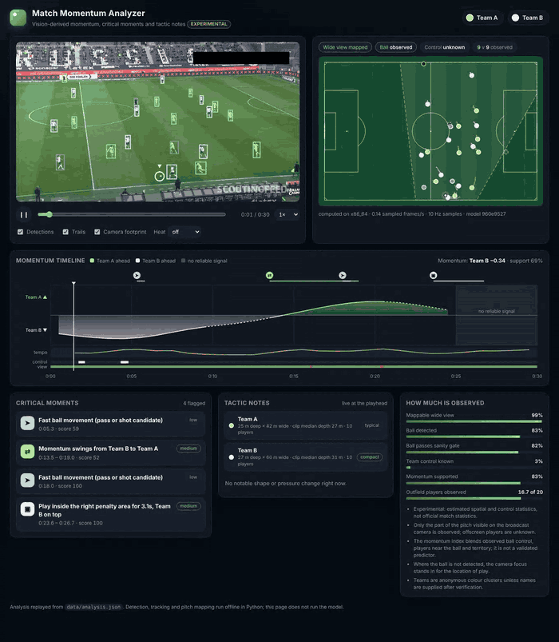

# Automatic pitch animation and match analysis

An experimental offline pipeline now adds shot-local BoT-SORT tracking, pinned PnLCalib reconstruction, bounded visual predictions, observed possession/events, coverage, heatmaps and a local Streamlit dashboard with synchronized video seeking. Possession-change inference is fully automatic from stable controlling-team colour changes, with per-frame evidence and CPU reprocessing of saved tracks. The broadcast iteration adds tiled ball detection, an optional separate adapted ball checkpoint, observed visible-group geometry and an independent annotation interface. Colab is the primary processing notebook; the CLI also runs on Kaggle.

See [setup, commands, artifact schema and evaluation protocol](docs/MATCH_ANALYSIS.md), [cloud notebook](notebooks/football_analysis_colab.ipynb) and [measured development results](docs/match_analysis_results.json) / [broadcast coaching iteration](docs/coaching_iteration_results.json). Accuracy targets are release gates; unmeasured or unmet gates remain experimental. No complete official match-statistics or named-player claims are made.

## Match momentum viewer



A static web viewer replays the offline analysis for a broadcast clip: a calibrated top-down pitch with tracked players and ball, the video with detections, a **momentum timeline**, ranked **critical moments** with the evidence behind each, and **tactic notes** that update with the playhead. [Open the live demo](https://rockenzo.github.io/ML-object-detection-project/) ([MP4 walkthrough](docs/viewer-demo.mp4)). It runs no model in the browser; detection, tracking and pitch mapping run in Python and are exported by one command.

```bash
python -m match_analysis analyze --video input_videos/08fd33_4.mp4 \
  --checkpoint runs/performance-study/improved/weights/best.pt --config configs/match.json \
  --device 0 --output artifacts/match
python -m match_analysis export-viewer --run artifacts/match --output web/data   # needs ffmpeg
python -m http.server -d web 8000
```

How each number is derived, the data contract and the limits are in [docs/VIEWER.md](docs/VIEWER.md). The committed demo (`web/data`) was produced from the bundled 30 s clip with a YOLOv8s detector fine-tuned in three rounds on the same training split (72 epochs at 640 px, then 960 px, then 1280 px with blur, noise and JPEG augmentation). On the validation split it reaches mAP50 **0.895** and ball recall **0.61** (ball mAP50 0.719), up from 0.751 and 0.16 for the detector behind the first demo; see [the report](reports/detector_ball1280robust_val_cpu_20261019.json) and [docs/TRAINING.md](docs/TRAINING.md) for how to fetch the weights. These are validation numbers from a small single-source dataset that was also used to choose the model, so they are optimistic: there is no independent test on other leagues, cameras or lighting, and the detector still misses about four in ten balls. It is **not industrial-grade**. Under image corruption (blur, noise, JPEG, darker, brighter, half resolution) validation mAP50 stays within about 0.02 of clean (worst case: heavy blur, 0.873 against 0.895) ([report](reports/robustness_ball1280robust_20261019.json)), but the training augmentations overlap those tests, so that is a stress test, not proof of generalisation.

Two pipeline fixes mattered as much as the detector. The ball confidence thresholds were tuned for the old detector and threw away most balls from the new one (`configs/match_ball1280.json` re-chooses them from the validation precision-recall curve), and players whose jersey colour was unclear in some frames now take the team their track shows elsewhere (`recompute-control --propagate-teams`). Together they raise the share of the clip with a clear ball owner from about 6% to about 11%; the detector alone did not move it ([progression](reports/demo_run_progression_20261019.json)). That is still a small minority of the clip: the observed possession split (about 26% / 74%) is an unvalidated estimate from roughly three seconds of evidence, and the rest of the picture comes from player positions and the camera focus. Everything in the viewer is an estimate and the existing release gates still apply.

## Current evidence and model availability

| Capability | Published evidence | Limit |
| --- | --- | --- |
| Four-class detection | mAP50 **0.27327 → 0.81640**, mAP50–95 **0.11802 → 0.58107** | Fixed 135-frame / two clip-prefix-group test; not an independent full-match benchmark |
| Broadcast analysis | Saved tracking, mapping, ball and coverage results | Separate broadcast development/evaluation footage; detector scores above do not establish match-analysis quality |
| Possession transitions | Automatic observed-team control changes with abstention | Low ball/control coverage limits supported events; no complete official statistics claim |

See [detector results](reports/study_test_20260930.json) and [broadcast results and release gates](docs/MATCH_ANALYSIS.md). Reproduce or supply a four-class trained checkpoint before using the match-analysis pipeline. The bundled `models/yolov8s.pt` is an 80-class COCO initialization checkpoint, not the fine-tuned football model; evaluation rejects it. Generated detector/ball checkpoints and PnLCalib dependencies have separate setup steps documented in the analysis guide.

## Detector setup and experiments

This repository contains a four-class Roboflow football dataset (ball, goalkeeper, player, referee), sample video, pretrained YOLO weights, and scripts for annotated inference and evaluation.

## Setup

Use Python 3.10 or newer. From the repository root:

```bash
python -m venv .venv
source .venv/bin/activate
python -m pip install -r requirements.txt
```

The dataset is from [Roboflow Universe](https://universe.roboflow.com/roboflow-jvuqo/football-players-detection-3zvbc/dataset/1). Its export identifies the dataset license as CC BY 4.0. Check the source terms before redistributing the images.

## Annotated inference

```bash
python yolo_inference.py predict
python yolo_inference.py predict --input input_videos/08fd33_4.mp4 --output-dir runs/my-prediction
```

The default model is the bundled `models/yolov8s.pt`. This is a **pretrained** checkpoint. Fine-tuned checkpoints are generated by the documented experiments below and retained locally; no downloadable fine-tuned weights are bundled. Pass `--model path/to/your/best.pt` to evaluate or use a separately trained model. Predictions with drawn boxes are saved under the requested output directory. `python main.py predict` provides the same interface.

## Training and evaluation

The checked-in dataset has train, validation, and test image and label folders. Training uses the training split and validation uses the validation split:

```bash
python prepare_grouped_split.py
python run_experiment.py --epochs 10 --imgsz 320 --device cpu
```

Use the resulting `best.pt` checkpoint for a single, held-out **test** evaluation:

```bash
python yolo_inference.py --model runs/grouped-baseline/train/weights/best.pt evaluate --data artifacts/grouped/data.yaml
```

The command writes `runs/codex-evaluate/metrics.json` with box precision, recall, mAP@0.5, and mAP@0.5:0.95. Record the checkpoint, dataset version, image size, Ultralytics version, and exact command with any performance claim. The test split must remain untouched during model selection. Do not compare a YOLOv5 training result with inference from different YOLOv8 weights as though they were one model.

Historical **97.5% precision** and **85% less manual review** figures are not supported by the published experiments. The detector reports below use scoped, grouped test partitions; no manual-review time-saving study is published. Current profile descriptions use those scoped results and mark broadcast analysis experimental.

## Project layout

- `yolo_inference.py`: annotated prediction and test evaluation CLI
- `main.py`: compatibility entry point to the same CLI
- `models/`: bundled pretrained weights
- `training/football-players-detection-1/`: Roboflow dataset and `data.yaml`
- `input_videos/`: sample input
- `runs/`: generated predictions and evaluation results

## Grouped split and checkpoint validation

The original export has 612 train, 38 validation and 13 test images. Filename-derived video prefixes overlap between original splits, so random frame splits may overstate generalization. `prepare_grouped_split.py` validates annotations and creates a deterministic seed-42 split with entire filename-prefix groups assigned together: 477 train, 122 validation and 64 test images. It stores per-image/label hashes, group assignment and source paths in `artifacts/grouped/manifest.json`. Original inputs are retained. Filename prefixes are provisional video identities; upstream confirmation and match/near-duplicate auditing remain necessary.

Use Python 3.12 and `pip install -r requirements-experiment.txt` for the reviewed experiment runtime. `run_experiment.py` fits a fresh four-class model using training and validation groups, saves a training/checkpoint manifest, and evaluates the untouched test groups after training. The default ten-epoch, 320-pixel run is a short transfer-learning baseline, not proof of convergence or production quality. Increase training duration and select parameters using validation data only, then use a new frozen test study for additional performance claims.

Evaluation refuses the bundled 80-class COCO checkpoint and any class order differing from ball/goalkeeper/player/referee. It verifies every test image/label against the split manifest, and reports test groups, checkpoint/split hashes, runtime version, box precision/recall, mAP50 and mAP50-95. YOLO box precision is computed by the pinned Ultralytics evaluator; it is not an image-level correctness rate or a manually measured workflow saving.

## Historical baseline (2026-09-30)

Ten epochs at 320 pixels, batch 8, seed 42, MPS device, initialized from the bundled YOLOv8s checkpoint. The selected checkpoint was chosen using validation groups before test evaluation.

| Test metric | Result |
| --- | ---: |
| Images / provisional video groups | 64 / 3 |
| Mean box precision | 0.35248 |
| Mean box recall | 0.29783 |
| mAP50 | 0.29878 |
| mAP50-95 | 0.14464 |

[Per-class test report](reports/test_baseline_20260930.json), [training parameters and checkpoint hashes](reports/training_baseline_20260930.json), [split audit](reports/grouped_split_audit.json) and [validation learning curve](reports/training_curve_20260930.csv) are included. The trained checkpoint remains a local generated artifact, not a bundled downloadable model; reproduce it using the script. MPS reports some nondeterministic operations, so a fixed seed does not promise byte-identical weights across runs/devices.

These results do not support 97.5% precision or production readiness. Main next steps are validation-driven longer/higher-resolution training, error analysis for small balls and visually similar player roles, confirmed match/video identities and a separately frozen test study. Do not tune parameters on the published test results.

## Validation-driven performance study (2026-09-30)

The new experiment reserves two previously untested filename-prefix groups (`08fd33`, `42ba34`) before fitting either model. It quarantines all 64 frames from the historical test, keeps the 122-frame validation partition, and uses 342 full-frame training images and 135 final test images. Both models start fresh from the same bundled COCO checkpoint. They do not reuse historical weights, which had seen the new final groups during training.

The baseline uses 10 epochs at 320 pixels. The improved configuration uses at most 80 epochs at 640 pixels, early-stopping patience 20, and adds 280 native-resolution ball-centred crops to the training set only (622 training examples total). Full frames are retained. Crops retain annotations with centres inside and at least 70% visible area. Both runs use batch 8 and seed 42. This is a combined training configuration comparison; it does not isolate the contribution of each change.

Select the best checkpoint on validation, then choose inference resolution from the fixed `[640, 960, 1280]` grid by validation mAP50–95. Freeze that choice before final evaluation. The following commands reproduce the complete protocol from a fresh checkout:

```bash
python -m pip install -r requirements-experiment.txt
python prepare_grouped_split.py
python performance_study.py prepare
python performance_study.py train --variant base --epochs 10 --imgsz 320 --device mps
python performance_study.py train --variant improved --epochs 80 --imgsz 640 --device mps
python finalize_study.py select --device mps
python finalize_study.py test --device mps
python finalize_study.py report
```

Use `--device cpu` or a CUDA index on other hardware. Runtime and device can affect the results. Preparation and finalization refuse to overwrite frozen study outputs. Data, crop and model hashes, completed epochs, learning curves, validation resolution candidates, final per-class and per-group metrics are exported under `reports/study_*_20260930.*`.

Filename prefixes are provisional clip identities, and only two groups are represented in the final test. Independent match identities and near-duplicate separation are not established. Report these results as performance on this grouped Roboflow benchmark, not performance on unseen leagues, matches or production broadcasts. A single experiment has no estimate of variation across random seeds.

### Matched final-test results

Both configurations were evaluated once after all validation selection on the same 135 full-frame images / two provisional video-prefix groups. The selected training checkpoint is from epoch 63 of 80, evaluated at 1280 pixels.

| Metric | 10-epoch / 320 baseline | Improved configuration |
| --- | ---: | ---: |
| Mean box precision | 0.37376 | **0.83168** |
| Mean box recall | 0.25471 | **0.78330** |
| mAP50 | 0.27327 | **0.81640** |
| mAP50–95 | 0.11802 | **0.58107** |

| Class | Baseline AP50 | Improved AP50 | Improved recall |
| --- | ---: | ---: | ---: |
| ball | 0.00000 | 0.57857 | 0.57143 |
| goalkeeper | 0.23451 | 0.91402 | 0.78558 |
| player | 0.65469 | 0.98143 | 0.95028 |
| referee | 0.20389 | 0.79160 | 0.82593 |

The selected detector's per-group mAP50 is 0.77737 on `08fd33` (57 frames) and 0.77548 on `42ba34` (78 frames). AP is computed from ranked detections; per-group AP need not average to pooled AP. Small-ball recall is still 0.57143 on the pooled test and goalkeeper AP50 is only 0.42899 in `08fd33`. These are concrete error-analysis targets rather than solved capabilities.

See the [final test and per-group report](reports/study_test_20260930.json), [frozen validation resolution selection](reports/study_resolution_20260930.json), [full training arguments and checkpoint hashes](reports/study_training_20260930.json), [split/crop audit](reports/study_split_20260930.json), and [80-epoch learning curve](reports/study_curve_improved_20260930.csv).

Use the trained weights with the selected resolution for annotated inference:

```bash
python yolo_inference.py --model runs/performance-study/improved/weights/best.pt predict --imgsz 1280 --device mps
```

**Resume wording:** “Fine-tuned a four-class YOLOv8s football detector using small-ball crop augmentation and validation-based resolution selection; improved mAP50 from 0.273 to 0.816 and mAP50–95 from 0.118 to 0.581 on a fixed 135-frame, clip-prefix-grouped benchmark.”

This does not substantiate the historical 97.5% precision or manual-review savings claims. The historical baseline above uses a different test partition and is not the comparator for this improvement.

## Licence

AGPL-3.0, because the code and weights build on Ultralytics (AGPL-3.0). Third-party components, the dataset's CC BY 4.0 attribution and a note on the demo footage are in [NOTICE.md](NOTICE.md). Training in a container or in one deletable folder is described in [docs/TRAINING.md](docs/TRAINING.md).
